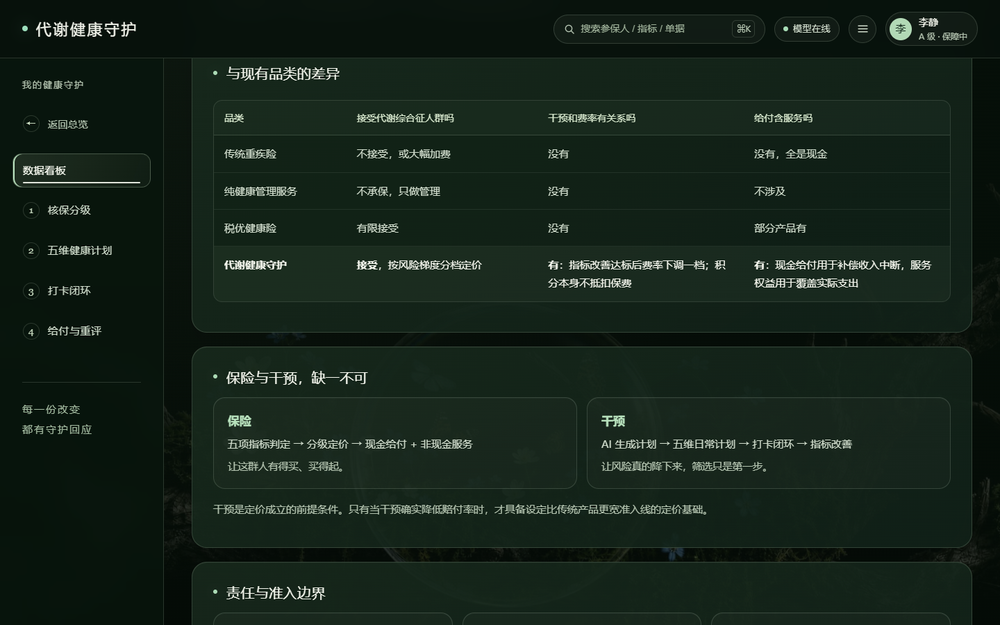

# 代谢健康守护 · AI 代谢管理教练

> 45–65 岁代谢综合征人群的特定疾病保险 + AI 生活方式干预 —— 把「多项指标偏高、又还没确诊任何疾病」这群被传统核保挡在门外的人，做成可计算、可定价、可干预的保险入口。

2026 第二届高校「智能+保险」创新创意大赛 · 团队参赛作品。

## 在线 Demo

**<https://juice-butterfly.github.io/metabolic-guardian/>**

- 单文件 HTML，无需安装、离线可跑；`index.html` 双击用浏览器打开效果相同。
- **AI 对话**需自备智谱 API Key：展开第 2 步的「模型设置」填入即可（[open.bigmodel.cn](https://open.bigmodel.cn) 可免费申请），Key 只存在浏览器 localStorage，不经过任何第三方；不填也不影响核保分级、健康计划、每日打卡、给付与重评四步演示。
- 内置三个投保人案例：李静（血糖型）/ 张建国（血压型）/ 王德明（血脂型），也可以自己填一组五项指标现场判定。

## 它解决什么问题

代谢综合征（MetS）= 腰围、血压、空腹血糖、甘油三酯、HDL-C 五项指标中 **≥3 项异常**，20 岁及以上人群患病率约 31%，基数以亿计。但这批人「还没确诊任何一种疾病」，落在传统重疾险的核保分类之外——**加费承保或直接拒保**，想买也买不到。

产品把 MetS 本身作为承保入口，靠三个创新点闭环：

| 创新点 | 一句话 |
|---|---|
| **分级定价** | 按五项指标的达标项数与偏离程度分 A / B / C 三档，各给一个明确费率，替代「要么大幅加费、要么拒保」 |
| **AI 代谢管理教练** | 每天的饮食与运动按本人五项指标现算，做了多少、指标怎么动，全部留痕可查——把临床试验里一年上万元、由真人执行的干预，变成多数人用得起的日常服务 |
| **年度重评降费** | 指标改善则等级下调、保费随之下降；积分只兑换实物与服务，绝不与保费挂钩（防「刷打卡」） |

保险这条腿负责准入与给付，AI 干预这条腿负责把风险真的降下来——**干预不是赠品，而是定价成立的前提**。

## 原型结构（三态页面）

| 页面 | 内容 |
|---|---|
| 首页 | 全屏视频 Hero（Organic Odyssey 视觉语言），单屏即收 |
| 产品介绍 | 数据看板 + 创新点（差异化矩阵、保险与干预缺一不可）、责任与准入边界、患病人群规模、准入漏斗、可保性测算，共 9 卡阅读层 |
| 四步操作 | 核保分级 → 五维健康计划（饮食 / 运动 / 提醒 / 快检 / 挑战 + AI 对话）→ 每日打卡 → 给付与年度重评 |

## 技术与口径

- **单文件原型**（约 2 MB，含内嵌 Hero 视频）：零依赖、无后端、无构建，动效纯 CSS/JS，适配 ≤640px 手机端。
- **AI 接入**：智谱 GLM（OpenAI 兼容协议，`glm-4-flash` 起步），前端直连；源码不含任何真实凭据。
- **判定口径**：CDS 标准（《中国糖尿病防治指南（2024 版）》），五项中任意三项达标即成立。
- **干预效果假设**：取自三大里程碑 RCT（大庆研究 / 芬兰 DPS / 美国 DPP）的保守取值（40%），属学术建模与情景模拟。
- **演示数据口径**：数据看板中仅 825 人（CHARLS 建模样本中 MetS 人数）与 44,628 / 28,536 / 16,092 元等锚点数字来自团队方案建模；参保人名单与逐周走势为演示用情景模拟（页面内已标注）。

## 免责声明

本仓库是比赛参赛原型，**不是真实保险产品**：不构成投保建议或要约，页面中的费率、给付与精算数字均来自团队学术建模与情景模拟，不代表任何保险机构的产品或费率；AI 生成的健康建议不构成医疗建议，不替代临床诊疗。
